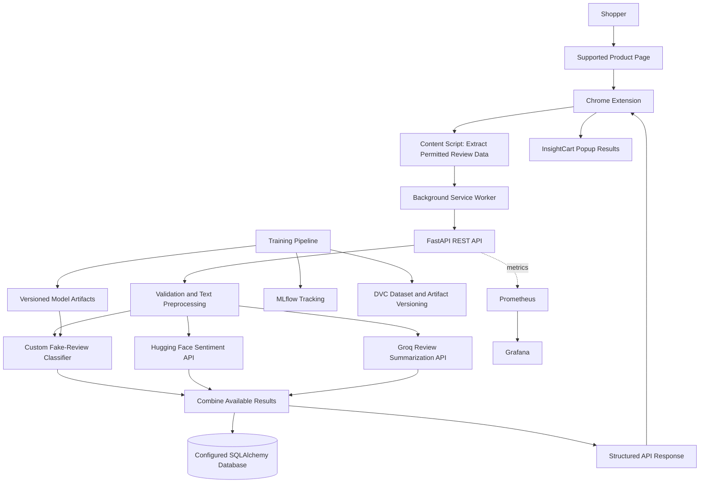
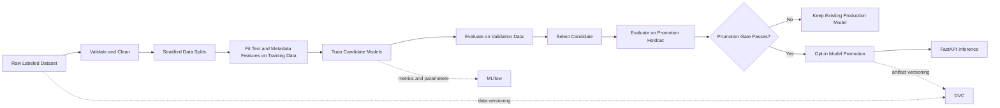

# InsightCart

**AI-Powered Shopping Intelligence Platform with MLOps**

> Shop Smarter with AI-Driven Product Insights

InsightCart is a local-first Chrome Extension and FastAPI application that helps shoppers understand product reviews without reading every review manually. It combines three distinct AI components: a custom-trained fake-review classifier, a Hugging Face sentiment-analysis model, and Groq API-powered review summarization.

The project also includes an MLOps workflow for reproducible training, experiment tracking, model/data versioning, automated testing, containerized local execution, and API monitoring.

## Table of Contents

- [Overview](#overview)
- [Key Features](#key-features)
- [AI Models](#ai-models)
- [Architecture](#architecture)
- [Technology Stack](#technology-stack)
- [Repository Structure](#repository-structure)
- [Dataset](#dataset)
- [Machine Learning Workflow](#machine-learning-workflow)
- [API Overview](#api-overview)
- [Configuration](#configuration)
- [Run Locally](#run-locally)
- [Run with Docker Compose](#run-with-docker-compose)
- [Chrome Extension Setup](#chrome-extension-setup)
- [Training and Model Evaluation](#training-and-model-evaluation)
- [DVC and MLflow](#dvc-and-mlflow)
- [Monitoring](#monitoring)
- [Testing and Code Quality](#testing-and-code-quality)
- [Security and Data Use](#security-and-data-use)
- [Limitations and Future Work](#limitations-and-future-work)
- [Troubleshooting](#troubleshooting)

## Overview

Online product listings can contain large numbers of repetitive, conflicting, or potentially misleading reviews. InsightCart extracts review information from a supported product page, sends the permitted review data to its backend, and presents review-level authenticity and sentiment results alongside an AI-generated summary.

The current project has three separate AI components:

1. **Custom fake-review detection model:** trained and evaluated within this project to classify a review as likely human-written or likely AI-generated/fake according to the training dataset's labels.
2. **Hugging Face sentiment model:** uses `cardiffnlp/twitter-roberta-base-sentiment-latest` to classify sentiment as positive, neutral, or negative.
3. **Groq summarization API:** generates a concise summary and structured findings from a supplied set of product reviews.

These components answer different questions. A negative review may be genuine, and a positive review may be suspicious; sentiment is not proof of authenticity. Model predictions are estimates and should not be treated as definitive judgments about an individual reviewer.

InsightCart is designed to run locally for development. The Hugging Face sentiment feature requires an eligible Hugging Face Inference Providers token, and Groq summarization requires a Groq API key. These two features therefore use external inference services even when the application and its MLOps tooling are run locally.

## Key Features

- Extract review details from supported shopping pages using a Chrome Extension.
- Predict review authenticity using the custom-trained classifier.
- Analyze sentiment as positive, neutral, or negative.
- Summarize supplied reviews using Groq.
- Present common pros, complaints, topics, sentiment distribution, and evidence references when available in the model response.
- Serve predictions through FastAPI.
- Track training experiments and evaluation metrics with MLflow.
- Version datasets and model artifacts with DVC.
- Run the application and local supporting services with Docker Compose.
- Validate code with automated tests and GitHub Actions.
- Expose service metrics for monitoring with Prometheus and Grafana when configured.

## AI Models

| Component | Implementation | Input | Output |
|---|---|---|---|
| Fake-review detection | Custom-trained scikit-learn pipeline using TF-IDF text features and encoded/scaled metadata where configured | Review text, rating, category | Predicted class and confidence/score supported by the trained pipeline |
| Sentiment analysis | Hugging Face Inference Providers with `cardiffnlp/twitter-roberta-base-sentiment-latest` | Review text | Positive, neutral, or negative label and provider confidence score |
| Review summarization | Groq API using the model configured by `GROQ_MODEL` | Product name and supplied reviews | Summary, pros, cons, topics, and other structured fields supported by the API schema |

### 1. Custom fake-review detection model

The classifier is trained from the project's labeled fake/genuine review dataset. The training pipeline performs data validation, preprocessing, feature generation, candidate model training, evaluation, and optional promotion of an approved model artifact.

The active API artifact is expected to be available at `artifacts/models/production_model_bundle.pkl` when a promoted bundle exists. If the bundle is absent, the application may use the legacy artifacts configured by the inference pipeline, including the calibrated classifier, TF-IDF vectorizer, category encoder, and rating scaler. Keep the artifact paths consistent with the actual configuration in your checkout.

The label meaning depends on the source dataset and its label mapping. Do not describe this model as a detector of all AI-written content unless its training data and evaluation specifically support that claim.

### 2. Sentiment analysis

The sentiment feature calls Hugging Face Inference Providers using the model `cardiffnlp/twitter-roberta-base-sentiment-latest`. It maps the model's output classes to negative, neutral, and positive labels.

The model was trained on Twitter-style text, so its performance on product reviews must be measured rather than assumed. The returned confidence is the provider's model score, not a calibrated guarantee that the prediction is correct. If the provider is not configured or is unavailable, the API should return a controlled error and the extension should indicate that sentiment is unavailable rather than silently substituting a different model.

### 3. Review summarization

The summarization feature sends user-supplied or otherwise authorized reviews to the Groq API. The model name is configured using `GROQ_MODEL`. The backend processes review batches within configured limits and returns a structured summary response.

The project does not include an authorized Amazon review collection provider by default. A collection route that depends on an unconfigured provider should return a clear `503` response; it must not claim that reviews were collected when no provider is configured. Use a data source whose terms authorize your intended access and processing.

## Architecture

### High-level system architecture



### Machine learning and MLOps lifecycle



The final test split is reserved for final reporting and must not be used for model selection or promotion. Promotion compares the candidate and active production model on the same promotion-holdout records. A promotion decision is a controlled local workflow, not a guarantee of real-world performance.

## Technology Stack

| Area | Technologies |
|---|---|
| Browser extension | Chrome Extension Manifest V3, JavaScript, HTML, CSS |
| UI components | React and Vite where used by the current frontend |
| Backend API | Python, FastAPI, Pydantic, Uvicorn |
| Custom ML model | scikit-learn, TF-IDF, calibrated Linear SVM and supporting preprocessing artifacts as configured |
| Sentiment inference | Hugging Face Inference Providers |
| Review summarization | Groq API |
| Database | SQLAlchemy with the database configured for the current environment; SQLite may be used locally, PostgreSQL is optional if configured |
| Experiment tracking | MLflow |
| Dataset and artifact versioning | DVC |
| Containerization | Docker and Docker Compose |
| Monitoring | Prometheus and Grafana, when configured |
| CI | GitHub Actions |
| Testing and linting | pytest and flake8 |

## Repository Structure

The exact files can differ as implementation evolves. The following is the intended high-level organization; retain the paths that exist in your checkout and do not create empty files solely to match this diagram.

```text
InsightCart/
├── app/
│   ├── main.py
│   ├── routes.py
│   ├── schemas.py
│   ├── models.py
│   └── services.py
├── artifacts/
│   ├── models/
│   ├── reports/
│   └── plots/
├── chrome_extension/
│   ├── manifest.json
│   ├── popup/
│   ├── background/
│   ├── content/
│   ├── assets/
│   └── icons/
├── config/
│   ├── config.yaml
│   ├── params.yaml
│   └── schema.yaml
├── data/
│   ├── raw/
│   ├── processed/
│   └── external/
├── docs/
├── notebooks/
├── src/
│   ├── components/
│   │   ├── data_ingestion.py
│   │   ├── data_validation.py
│   │   ├── data_transformation.py
│   │   ├── model_trainer.py
│   │   ├── model_evaluation.py
│   │   └── model_pusher.py
│   ├── pipeline/
│   │   ├── review_detection_training_pipeline.py
│   │   └── review_detection_inference_pipeline.py
│   ├── utils/
│   ├── constants.py
│   ├── exception.py
│   └── logger.py
├── tests/
├── .github/
│   └── workflows/
├── Dockerfile
├── docker-compose.yml
├── dvc.yaml
├── requirements.txt
├── setup.py
├── README.md
└── .gitignore
```

## Dataset

The custom fake-review classifier requires a labeled dataset with review text and a target label distinguishing the classes your model is intended to learn. Depending on the training pipeline, metadata such as rating and category may also be required.

Expected raw dataset path in this project:

```text
data/raw/fake_reviews_dataset.csv
```

Confirm the exact column names and label values against `config/schema.yaml` and the data-validation code before training. Do not assume that every public dataset uses the same schema or that a dataset's `fake` label means specifically AI-generated text; some datasets label deceptive or synthetic reviews using different definitions.

Recommended dataset handling:

- Keep the original dataset unchanged in `data/raw/`.
- Use the validation and transformation pipeline to create processed data.
- Remove exact duplicates and handle missing required values according to the configured schema.
- Split the data before fitting feature transformations.
- Fit TF-IDF, category encoding, and any scaling only on the training partition.
- Use a stratified split where class distributions permit it.
- Record the dataset checksum and evaluation metadata.
- Check the dataset license, permitted uses, and any redistribution restrictions before committing or sharing it.

## Machine Learning Workflow

The custom classifier's training workflow is:

1. Ingest the versioned raw dataset.
2. Validate required columns, labels, data types, and missing values.
3. Remove duplicates and preprocess review text.
4. Create separate training, validation, promotion-holdout, and final-test partitions according to the pipeline configuration.
5. Fit text and metadata transformations on training data only.
6. Train the configured candidate algorithms.
7. Compare candidates using validation metrics, with the configured primary metric and tie-breaker.
8. Evaluate the selected candidate on the promotion holdout and compare it with the active production model on the same records.
9. Promote only when explicitly requested and when the configured promotion gate passes.
10. Save reports and versioned artifacts; log training parameters and aggregate metrics to MLflow when configured.

Useful evaluation outputs may include accuracy, precision, recall, F1 score, ROC-AUC where applicable, confusion matrix, dataset SHA-256, and a fingerprint of held-out records. Report metrics from your actual run; do not copy example values into project claims.

## API Overview

Start the backend and open the interactive API documentation at:

```text
http://localhost:8000/docs
```

The current project includes or documents these feature routes. Verify the exact route prefixes in `app/main.py` and the router modules before relying on them.

## API Endpoints

InsightCart provides REST API endpoints for health monitoring, fake-review detection, sentiment analysis, AI-powered review summarization, and application monitoring. The backend API can be explored through the Swagger UI.

**Base URL:** `http://localhost:8000`

**Interactive API Documentation:** `http://localhost:8000/docs`

### 1. General Endpoints

| Method | Endpoint | Description |
|---|---|---|
| `GET` | `/` | Returns the application's home or welcome response. |
| `GET` | `/health` | Checks the overall health of the API service. |
| `GET` | `/metrics` | Exposes application metrics for Prometheus monitoring. |

### 2. Review Detection

These endpoints detect whether a product review is potentially fake or genuine using the configured review-classification model.

| Method | Endpoint | Description |
|---|---|---|
| `POST` | `/api/v1/review/predict` | Predicts whether a single review is fake or genuine. |
| `POST` | `/api/v1/review/predict/batch` | Predicts whether multiple reviews are fake or genuine in a single request. |

### 3. Sentiment Analysis

These endpoints analyze the emotional tone of product reviews and classify sentiment using the configured sentiment-analysis service.

| Method | Endpoint | Description |
|---|---|---|
| `POST` | `/api/v1/sentiment/analyze` | Analyzes the sentiment of a single review. |
| `POST` | `/api/v1/sentiment/analyze/batch` | Analyzes the sentiment of multiple reviews in a single request. |

### 4. AI-Powered Review Summarization

These endpoints summarize customer reviews, identify key topics, highlight advantages and disadvantages, and provide a product-level recommendation.

| Method | Endpoint | Description |
|---|---|---|
| `POST` | `/api/v1/review-summary/summarize` | Generates a summary from reviews supplied in the request. |
| `POST` | `/api/v1/review-summary/products/{product_id}/analyze` | Collects reviews through a configured review provider and generates a product-level summary. |
| `GET` | `/api/v1/review-summary/products/{product_id}` | Retrieves the latest available summary for a product. |
| `GET` | `/api/v1/review-summary/products/{product_id}/history` | Retrieves the available summary history for a product. |
| `GET` | `/api/v1/review-summary/health` | Checks the health and configuration status of the review-summarization service. |

**Note:** The product-level analysis endpoint requires a configured review provider. If no authorized provider is configured, the endpoint may return a `503 Service Unavailable` response. The availability of a stored summary or summary history depends on the application's database and implementation.

### 5. Monitoring

| Method | Endpoint | Description |
|---|---|---|
| `GET` | `/metrics` | Provides application metrics in a format suitable for Prometheus scraping, when metrics instrumentation is enabled. |

### 6. HTTP Methods

| Method | Purpose |
|---|---|
| `GET` | Retrieves information or checks service status. |
| `POST` | Submits data for prediction, analysis, or summarization. |

### 7. Accessing the API

To run the API locally, start the backend server and open the following URLs:

| Resource | URL | Purpose |
|---|---|---|
| API Base URL | `http://localhost:8000` | Root address of the backend API. |
| Swagger UI | `http://localhost:8000/docs` | Interactive documentation for exploring and testing endpoints. |
| ReDoc | `http://localhost:8000/redoc` | Alternative API documentation interface, if enabled. |
| Health Check | `http://localhost:8000/health` | Checks the overall API health. |
| Prometheus Metrics | `http://localhost:8000/metrics` | Displays application metrics, if enabled. |

**Important:** These URLs assume the backend is running locally on port `8000`. When running through Docker or deploying to another environment, use the corresponding host and port.

The review-summary product collection route depends on a configured, authorized provider. Without one, it should return `503 review_provider_not_configured`. The supplied-review summarization route can be used independently by sending reviews in the request body.

### Example: fake-review prediction

The actual request schema is authoritative. The batch route is used by the extension and expects a `reviews` array. A single-review example may look like this if the application exposes a matching single-review schema:

```json
{
  "review": "Excellent battery life and premium build quality.",
  "rating": 5,
  "category": "Electronics_5"
}
```

Example response shape; values are illustrative, not measured results:

```json
{
  "review_type": "Human-Written Review",
  "confidence": 94.63,
  "reason": "The model's prediction and explanation fields indicate the predicted class."
}
```

### Example: sentiment analysis

```bash
curl -X POST http://localhost:8000/api/v1/sentiment/analyze \
  -H 'Content-Type: application/json' \
  -d '{"review":"The packaging was simple and the headphones sound excellent."}'
```

A successful response contains fields such as `success`, `sentiment.label`, `sentiment.confidence`, `model.provider`, `model.name`, and `processing_time_ms`, according to the current schema. Runtime values vary.

### Example: review summarization

```bash
curl -X POST http://localhost:8000/api/v1/review-summary/summarize \
  -H 'Content-Type: application/json' \
  -d '{
    "product_id": "SKU-123",
    "product_name": "Example headphones",
    "reviews": [
      {
        "review_id": "r-1",
        "title": "Comfortable",
        "text": "Comfortable for long flights, but the case feels flimsy.",
        "rating": 4,
        "review_date": "2026-01-15",
        "source": "authorized-provider"
      }
    ]
  }'
```

Only send reviews that you are authorized to process. Evidence references in the response can only point to review IDs included in the submitted data and supported by the service's validation rules.

## Configuration

Create a local `.env` file in the repository root. Do not commit it.

Example settings for the external AI providers:

```dotenv
HF_SENTIMENT_ENABLED=true
HF_TOKEN=your_hugging_face_user_access_token
HF_SENTIMENT_MODEL=cardiffnlp/twitter-roberta-base-sentiment-latest
HF_SENTIMENT_TIMEOUT=30
HF_SENTIMENT_MAX_LENGTH=512

GROQ_API_KEY=your_groq_api_key
GROQ_MODEL=openai/gpt-oss-120b
GROQ_TIMEOUT=60
REVIEW_SUMMARY_MAX_REVIEWS=1000
REVIEW_SUMMARY_BATCH_TOKENS=6000
REVIEW_SUMMARY_CACHE_TTL_HOURS=24
```

Use a Groq model that is currently available to your account. The model name above reflects a model that worked in the described development setup; model availability can change. If a provider rejects a model name, check the provider's current model list and update `GROQ_MODEL`.

Keep provider credentials on the backend only. Never put `HF_TOKEN` or `GROQ_API_KEY` in frontend variables such as `VITE_*`, return them from an API endpoint, or print them in logs. Restart the backend after editing `.env`.

Database, MLflow, DVC remote, and monitoring settings depend on your current configuration. Check `app/config.py`, `config/`, and `docker-compose.yml` for the actual variable names rather than adding undocumented environment variables.

## Run Locally

Run commands from the repository root.

### 1. Create and activate a virtual environment

```bash
python3 -m venv .venv
source .venv/bin/activate
python -m pip install --upgrade pip
python -m pip install -r requirements.txt
```

If your project already uses a virtual environment named `venv`, activate that environment instead and use its Python executable consistently.

### 2. Configure environment variables

Create `.env` and add the backend settings needed for the features you want to run. The fake-review API can run with local model artifacts; Hugging Face sentiment and Groq summarization require their respective provider credentials.

### 3. Verify model artifacts

Before starting the API, ensure the required model files are present. If the artifacts are DVC-managed and a DVC remote is configured, pull them as described in [DVC and MLflow](#dvc-and-mlflow).

### 4. Start FastAPI

```bash
python -m uvicorn app.main:app --reload --host 127.0.0.1 --port 8000
```

If your app's import path differs, use the module path defined by your repository. The expected import path for the current project setup is `app.main:app`.

### 5. Verify the API

Open:

```text
http://localhost:8000/docs
```

Call the health endpoint registered by your application and test the relevant prediction route. Check the terminal logs for startup errors, missing model artifacts, or provider configuration failures.

## Run with Docker Compose

Docker Compose is the recommended way to run the configured local service stack when its services and environment are ready.

```bash
docker compose config
docker compose up --build
```

To run services in the background:

```bash
docker compose up --build -d
docker compose ps
docker compose logs -f insightcart-api
```

The service name may differ in your Compose file; use `docker compose config --services` to list the actual names.

If the API image copies model artifacts during build, make sure the DVC-managed artifacts have been pulled before building. A container build does not automatically fetch files from a DVC remote unless the Dockerfile explicitly implements that step.

Stop the stack with:

```bash
docker compose down
```

Persistent data stored in named volumes is not necessarily removed by this command. Review the Compose file before deleting volumes.

## Chrome Extension Setup

1. Start the FastAPI backend and verify the API is reachable.
2. Open `chrome://extensions` in Chrome.
3. Enable **Developer mode**.
4. Select **Load unpacked** and choose the `chrome_extension/` directory.
5. Open a supported product or review page.
6. Open the InsightCart popup and select **Analyze Reviews**.
7. Use Chrome DevTools to inspect the extension service worker and the page's Network panel if a request fails.

The extension's current batch authenticity request is documented as:

```text
POST http://localhost:8000/api/v1/review/predict/batch
```

The request body contains a `reviews` array. The documented review fields include `review`, `rating`, and `category`; other extracted fields are only accepted if declared by the request schema. The backend should validate request data and avoid logging full review text.

The extension can only analyze reviews that it successfully extracts and is permitted to access. Page markup varies, so extraction may not work on every product page or website. Do not assume that opening a product page means the extension has collected every review for that product.

## Training and Model Evaluation

The custom classifier training pipeline is separate from the Hugging Face sentiment and Groq summarization services. The latter two are external inference services and are not trained by this project's fake-review training pipeline.

Check the available command-line options before running a long experiment:

```bash
python src/pipeline/review_detection_training_pipeline.py --help
```

A documented manual candidate run is:

```bash
python src/pipeline/review_detection_training_pipeline.py \
  --dataset data/raw/fake_reviews_dataset.csv \
  --output-dir artifacts/experiments/manual-candidate
```

If the repository uses a dedicated DVC stage, run:

```bash
dvc status
dvc repro train_candidate
```

Use the command supported by the checked-in pipeline and `dvc.yaml`; if the stage name or CLI arguments differ, follow those files. Candidate outputs should be written to a separate experiment directory and should not overwrite the active production model unless an explicit promotion workflow passes its configured gate.

### Model promotion

Promotion should be opt-in. The candidate and production model must be evaluated on the same promotion-holdout records. A failed gate must leave the active production artifact unchanged. The final test set must not be used to choose a candidate or decide whether to promote it.

Promotion thresholds are project configuration, not universal standards. Set minimum accuracy, precision, recall, F1, primary metric, and minimum improvement based on the consequences of false positives and false negatives. A single holdout score is not proof of statistical reliability.

## DVC and MLflow

### DVC

DVC versions the raw dataset and model artifacts without requiring large files to be committed directly to Git.

Useful commands:

```bash
dvc status
dvc pull
dvc repro train_candidate
dvc push
```

The repository's configured DVC remote must be accessible before `dvc pull` or `dvc push` can succeed. A local remote such as `../dvc_storage` is only available on machines where that path exists; GitHub-hosted runners need a reachable remote and any required credentials configured as repository or environment secrets.

Do not put remote credentials in source control. Review the `.dvc` pointer files and the remote configuration before sharing the repository with another machine.

### MLflow

MLflow records training experiments, parameters, aggregate metrics, and artifacts. The project may also use a separate experiment for API tracing. Training metrics and request traces serve different purposes and should not be treated as the same experiment.

If using a local SQLite-backed tracking store, start the MLflow server using the repository's configured URI and port. Example for a trusted local development environment:

```bash
mlflow server \
  --backend-store-uri sqlite:///mlflow.db \
  --host 127.0.0.1 \
  --port 5000
```

Open `http://127.0.0.1:5000` to access the UI. If Docker containers need to reach a host-run MLflow server, configure the host binding and allowed-host settings according to your installed MLflow version and local network. Do not expose the tracking server publicly.

## Monitoring

When enabled in the current configuration:

- **Prometheus** scrapes API metrics such as request counts, latency, and errors.
- **Grafana** visualizes metrics using Prometheus as a data source.
- **MLflow** stores training experiment results and, if configured, API traces.

Confirm the actual metrics path, Compose service names, scrape targets, ports, and dashboard provisioning in `docker-compose.yml` and the Prometheus/Grafana configuration. Monitoring components are available only when their services and instrumentation are configured and running.

## Testing and Code Quality

Run tests from the repository root in the same virtual environment as the backend:

```bash
pytest -q
flake8 app src tests scripts
```

Some repositories may not contain every directory shown in the lint command; adjust paths to match the checkout. API tests should mock external inference providers so that ordinary test runs do not require Hugging Face or Groq credentials or network access.

A real sentiment evaluation requires a manually labeled, representative product-review dataset. For a three-class evaluation, use labels `positive`, `neutral`, and `negative` and report per-class precision, recall, F1, overall accuracy, and a confusion matrix. Do not claim product-review performance until the evaluation has actually been run.

GitHub Actions should validate code with linting, tests, configuration checks, and Docker builds. A hosted training workflow that pulls DVC data also requires a reachable DVC remote and appropriate credentials. CI should not promote a production model automatically unless an explicitly reviewed release process allows it.

## Security and Data Use

- Keep `.env`, access tokens, and API keys out of Git.
- Never expose provider credentials through the extension or browser-visible frontend code.
- Do not log raw review text, credentials, or other sensitive payloads.
- Use review sources and datasets only in ways permitted by their terms and licenses.
- Tell users when review text is sent to external inference providers.
- Treat authenticity, sentiment, and recommendation outputs as probabilistic assistance, not verified facts.
- Restrict local monitoring and MLflow services to trusted development access.

## Limitations and Future Work

Current limitations and possible future improvements include:

- Evaluate the custom classifier on a representative, manually verified dataset and monitor class imbalance and data leakage.
- Evaluate the Twitter-trained sentiment model on product reviews before making quality claims.
- Add an authorized review provider if automated product-level review collection is required.
- Add semantic review search and natural-language review Q&A using embeddings.
- Improve recommendation and trust-score logic only after defining and validating its inputs and evaluation criteria.
- Add scheduled retraining and model-drift monitoring after reliable feedback and evaluation data are available.
- Improve page-specific extraction and add tests for supported shopping sites.

## Troubleshooting

<details>
<summary><strong>API fails to start</strong></summary>

- Activate the intended virtual environment.
- Install dependencies with `python -m pip install -r requirements.txt`.
- Confirm that `app.main:app` is the correct import path.
- Check startup logs for missing model files, invalid settings, or database errors.

</details>

<details>
<summary><strong>Fake-review prediction reports missing artifacts</strong></summary>

- Confirm the model bundle or the legacy model files exist at the paths expected by the inference pipeline.
- If the files are DVC-managed, run `dvc status` and pull the required artifacts from a reachable remote.
- Rebuild the Docker image if artifacts are copied into the image during build.

</details>

<details>
<summary><strong>Hugging Face sentiment returns an error</strong></summary>

- Confirm `HF_SENTIMENT_ENABLED=true`.
- Confirm `HF_TOKEN` is configured in the backend environment and has the required Inference Providers access.
- Verify the model name and provider availability.
- Check rate limits and service status. The API should report a controlled error rather than silently changing models.

</details>

<details>
<summary><strong>Groq summary returns an error</strong></summary>

- Confirm `GROQ_API_KEY` is set on the backend and restart the API after editing `.env`.
- Verify that `GROQ_MODEL` is currently available to your Groq account.
- Check request size and configured review/batch limits.
- Do not expose the API key in logs or frontend variables.

</details>

<details>
<summary><strong>Extension cannot reach the API</strong></summary>

- Confirm the backend is running at the URL used by the extension.
- Inspect the browser Network panel and service worker console for the request URL, status code, and safe error details.
- Check the extension's host permissions and the backend's CORS configuration.
- Confirm the request path matches the route registered by FastAPI.

</details>

<details>
<summary><strong>DVC or CI cannot find the dataset</strong></summary>

- Check `dvc status` and the configured remote.
- A local remote path may not exist on a clean checkout or hosted CI runner.
- Configure a reachable remote and credentials using secure CI secrets before running hosted training.

</details>

## License

Add the license that applies to this repository and verify that it is compatible with the licenses and terms of the datasets, models, and services used by InsightCart.
